<div align="center">

# 🥷 Ninja Run

**A momentum-based physics platformer for iPhone, iPad and Android.**

Run, jump off walls, grab gold before the clock runs out, and dodge mines, drones, turrets and homing rockets.


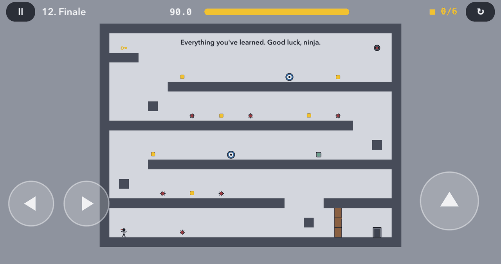

</div>

## Inspiration

I made Ninja Run inspired by **[N v2.0](https://www.thewayoftheninja.org/nv2.html)**, the classic Flash game by
[Metanet Software](https://www.metanetsoftware.com/) (see also [N on The Way of the Ninja](https://www.thewayoftheninja.org/n.html)).
I loved how its tiny stick-figure ninja moves: heavy momentum, floaty jumps, wall-jumps, and the way a fall from too high
turns you into a ragdoll. I wanted to bring that feel to touch screens.

Ninja Run is an independent fan project and is not affiliated with Metanet Software. All code, levels, graphics and sounds
were made from scratch for this game. No assets from the original are used.

## Features

- **Physics that feel like N**: acceleration and momentum, a higher jump when you hold the button, wall jumps and wall
  slides, 45° slopes, and fatal impacts from long falls or hard ceiling hits.
- **Race against the clock**: every level starts with 90 seconds, and each piece of gold adds 2 more. Your best time
  left on each level is saved.
- **12 hand-made levels** that introduce one idea at a time: mines, keys and doors, launchpads, patrol drones, chasers,
  a gauss turret and homing rockets.
- **Procedural art**: the ninja is a stick figure drawn and animated in code, with a red headband that flutters as it
  moves and a ragdoll burst when it dies.
- **Synthesized sound effects**: soft retro sounds generated at launch, with no audio files.
- **7 languages**: English, Русский, Español, Deutsch, Italiano, Français, 中文. The game uses the device language
  by default, and you can switch in the menu.
- **Touch and keyboard**: on-screen controls, plus arrows / WASD / Space on a hardware keyboard, in the iOS Simulator
  or the Android emulator.
- **Native on both platforms**: Swift + SpriteKit on iOS, Kotlin + Canvas on Android. The physics, levels, sounds and
  texts are the same, and a unit test checks that the Android physics matches the iOS numbers.

## Screenshots

<table>
  <tr>
    <td>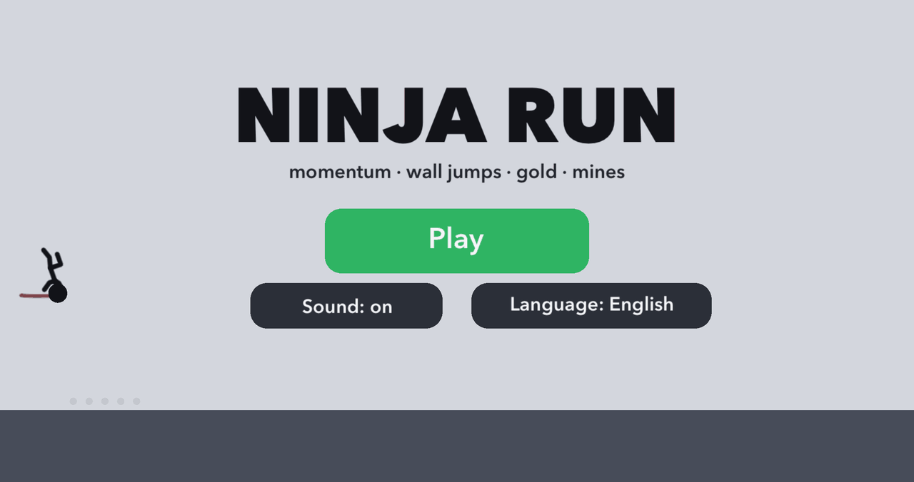</td>
    <td>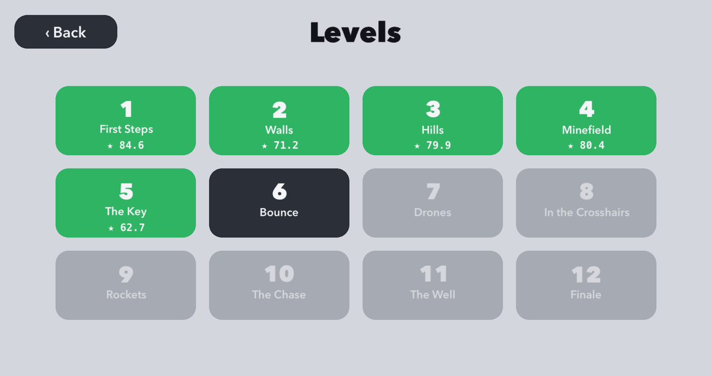</td>
  </tr>
  <tr>
    <td align="center"><sub>The main menu: the ninja runs and shows off flips</sub></td>
    <td align="center"><sub>Level select with best times</sub></td>
  </tr>
</table>

## Levels

Each level is a single 31 × 23 tile room. Press the **green switch** to open the **exit door**, then reach the door.
Gold is optional, but every piece adds 2 seconds to the clock.

<table>
  <tr>
    <td width="33%" valign="top">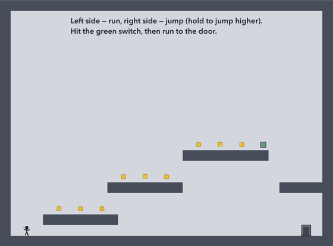<br><b>1. First Steps</b><br><sub>Running, jumping and the basic loop. Climb a staircase of platforms, hit the switch, reach the door.</sub></td>
    <td width="33%" valign="top">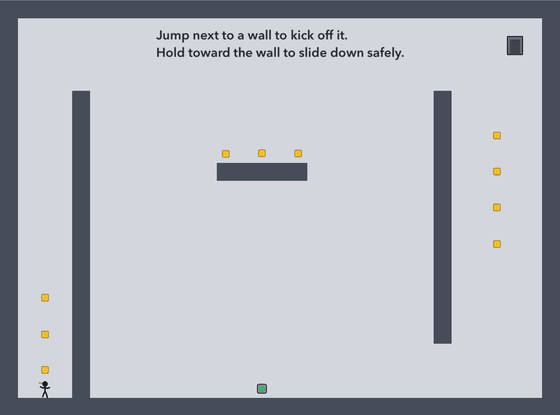<br><b>2. Walls</b><br><sub>Wall jumps. Climb out of a narrow shaft, slide down the walls safely, then climb again to a door near the ceiling.</sub></td>
    <td width="33%" valign="top">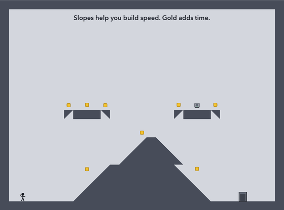<br><b>3. Hills</b><br><sub>Slopes. Run over a big pyramid and jump from its peak to floating platforms with angled undersides.</sub></td>
  </tr>
  <tr>
    <td valign="top">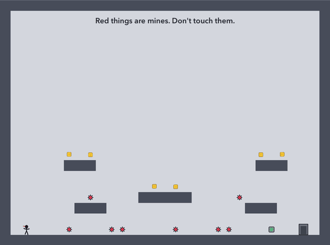<br><b>4. Minefield</b><br><sub>Mines on the floor and on the platforms. Short, precise hops matter here.</sub></td>
    <td valign="top">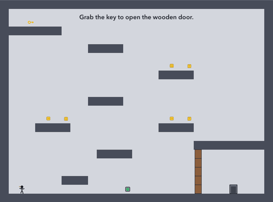<br><b>5. The Key</b><br><sub>Zig-zag up the platforms to a key that unlocks the wooden door guarding the exit. Then find a safe way back down.</sub></td>
    <td valign="top">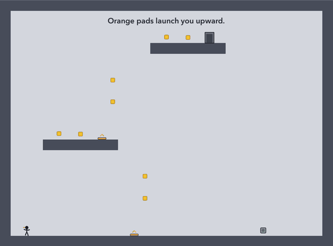<br><b>6. Bounce</b><br><sub>Orange launchpads throw you far higher than a jump. Steer in the air to land on the platforms above.</sub></td>
  </tr>
  <tr>
    <td valign="top">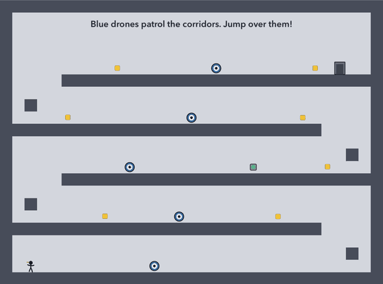<br><b>7. Drones</b><br><sub>Four floors, each patrolled by a zap drone. Jump over them and climb through the gaps to the top.</sub></td>
    <td valign="top">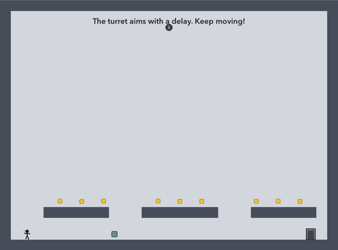<br><b>8. In the Crosshairs</b><br><sub>A gauss turret watches the whole room. Its aim lags behind you, then freezes and blinks for half a second before the shot: jump or step aside.</sub></td>
    <td valign="top">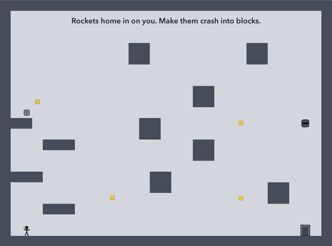<br><b>9. Rockets</b><br><sub>A launcher fires homing rockets. Break line of sight and lure them into the blocks.</sub></td>
  </tr>
  <tr>
    <td valign="top">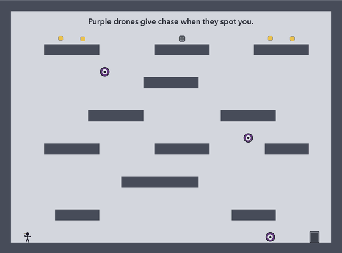<br><b>10. The Chase</b><br><sub>Purple chaser drones dash at you as soon as you share a row or column with them.</sub></td>
    <td valign="top">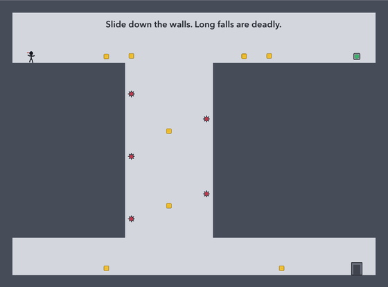<br><b>11. The Well</b><br><sub>Descend a deep shaft lined with mines. Switch walls mid-slide, because a free fall is fatal.</sub></td>
    <td valign="top">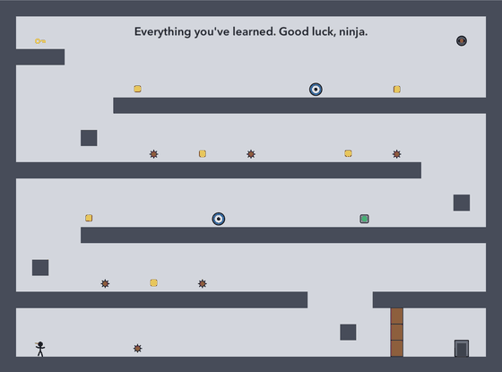<br><b>12. Finale</b><br><sub>Everything at once: a key and door, mines, drones and a turret across five floors.</sub></td>
  </tr>
</table>

## Controls

| Action | Touch | Keyboard |
| --- | --- | --- |
| Run left / right | Left half of the screen (◀ ▶, you can slide your finger) | ← → or A D |
| Jump (hold to jump higher) | Right half of the screen | Space, ↑, W or Z |
| Wall jump | Jump while touching a wall | same |
| Wall slide | Hold toward the wall while falling | same |
| Restart after death | Jump, or wait a moment | same |

## Build and run

The repository holds two native apps that share the same design:

```
ios/       Swift + SpriteKit (Xcode project)
android/   Kotlin + Canvas (Gradle project)
docs/      README screenshots
```

Neither app has third-party dependencies.

### iOS

Requirements: **Xcode 16 or newer**, iOS 16+.

1. Open `ios/NinjaRun.xcodeproj`.
2. Choose a simulator or your device and press **Run** (⌘R).
3. On a real device, pick your team under *Signing & Capabilities* first.

### Android

Requirements: **Android Studio** (or JDK 17+ and the Android SDK), Android 9+ devices.

1. Open the `android/` folder in Android Studio and press **Run**, or from a terminal:
   ```bash
   cd android
   ./gradlew installDebug
   ```
2. Physics tests: `./gradlew testDebugUnitTest`.

## How it works

Both versions have the same structure:

| iOS (`ios/NinjaRun/`) | Android (`android/app/src/main/java/…/ninjarun/`) | Contents |
| --- | --- | --- |
| `Geometry.swift` | `Geometry.kt` | Tiles (squares and four slope types), circle-vs-polygon collision, raycasts |
| `Player.swift` | `Player.kt` | Ninja physics (constants in `Player.Tuning`) and the procedural stick figure |
| `Entities.swift` | `Entities.kt` | Gold, mines, switch, exit door, keys, launchpads, drones, turrets, rockets |
| `GameScene.swift` | `GameScreen.kt` | Fixed 60 Hz game loop, HUD, touch controls, pause and win screens |
| `MenuScenes.swift` | `MenuScreens.kt` | Main menu with the animated ninja, language picker, level select |
| `Levels.swift` | `Levels.kt` | All levels as ASCII maps |
| `Localization.swift` | `Localization.kt` | UI text, level names and hints in 7 languages |
| `Sound.swift` | `Sound.kt` | Synthesized sound effects (`AVAudioEngine` / `SoundPool`) |
| `App.swift`, `UI.swift` | `MainActivity.kt`, `GameView.kt`, `UI.kt` | App entry, frame loop, buttons and input routing |

The ninja is a circle with a radius of 10 points in a world of 24-point tiles. Each frame runs in 4 substeps. Every
substep pushes the circle out of nearby tile polygons and removes the velocity going into the surface. The speed of
that impact decides whether you survive a landing.

### Making levels

Levels are plain text, 31 columns × 23 rows. Keep `ios/NinjaRun/Levels.swift` and `android/…/Levels.kt` in sync:

```
#  solid tile        /  \  floor slopes      7  p  ceiling slopes
P  ninja start       G  gold                 M  mine
S  exit switch       E  exit door
k  key               D  door tile (opens when every key is collected)
^  launchpad         e w n s  zap drone (initial direction)    c  chaser drone
T  gauss turret      r  rocket turret
```

Debug builds accept launch arguments that help with testing and screenshots:

- iOS: `-screen level5` opens a level directly, `-screen levels` opens the level list, `-lang en` forces a language,
  and `-hideControls YES` hides the on-screen buttons.
- Android: `adb shell am start -n com.makarevich.ninjarun/.MainActivity --es screen level5 --es lang en`.
